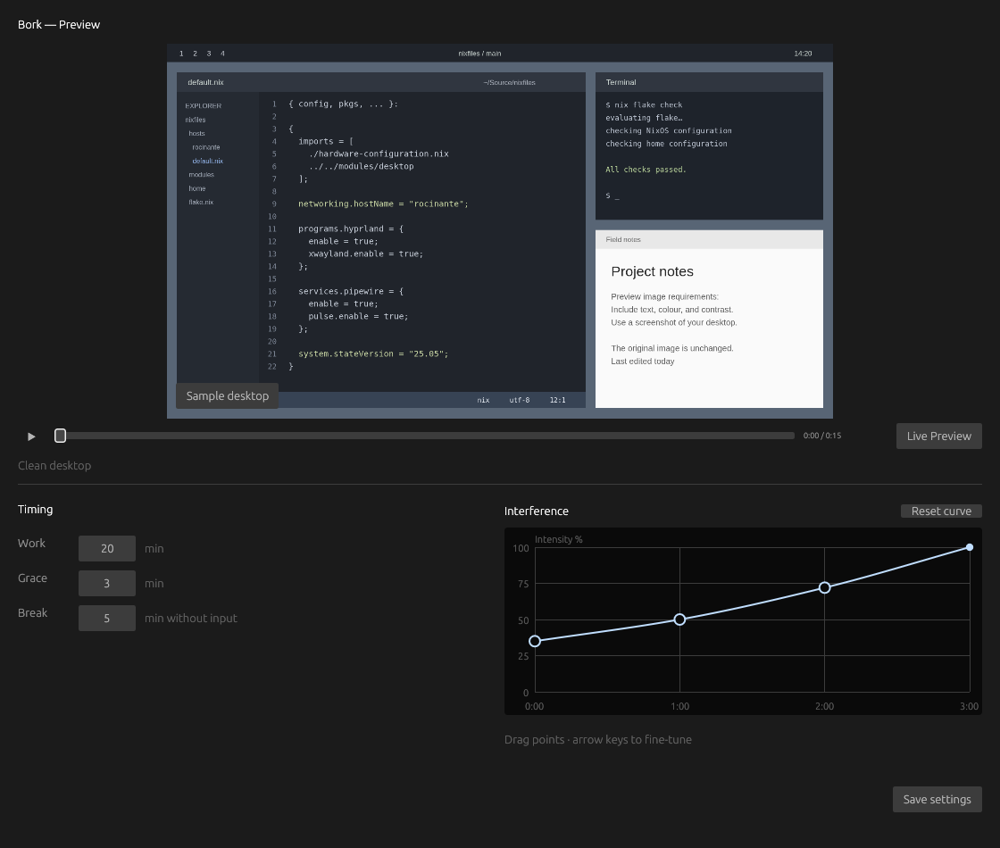

<div align="center">

# Bork

Take a break. Or get borked.

[](https://github.com/hschne/bork/actions/workflows/check.yml) [](LICENSE)

</div>

There's always more to do. Sometimes it's hard to take a breather - even though you know you should. It's a lot easier if your device starts to... gently remind you to do so.

https://github.com/user-attachments/assets/b0b9b12f-b456-47ea-9d5c-ac37c8b34649

## Install

Download from [GitHub Releases](https://github.com/hschne/bork/releases):

```sh
curl -fsSL https://github.com/hschne/bork/releases/latest/download/install.sh | sh
bork preview
```

Installs to `~/.local/bin/bork` and verifies the download checksum. Keep `~/.local/bin` on your `PATH`.

### Requirements

- [Hyprland](https://hypr.land/)
- [glibc](https://www.gnu.org/software/libc/) 2.35+

## Usage

```sh
bork            # Run the background timer (or configure autostart below)
bork preview    # Preview effects and configure timing
bork pause      # Clear effects and pause the timer
bork resume     # Continue
bork reset      # Clear effects and start a fresh interval; also recover after a crash
```

## Configuration

Run `bork preview` to edit timings and intensity of effects, and preview the results. The timer defaults to 20 minutes of work, 3 minutes of escalating interference, and a 5-minute break without input. Shorter pauses retain work debt; a completed break starts a fresh interval when you return.



You may edit settings in `$XDG_CONFIG_HOME/bork/settings.json` or use the CLI:

```sh
bork config list
bork config set timing.work_seconds 1500
```

### Overtime Card

The default background is embedded in the executable. Set `overtime.background.image` to use your own image. The `overtime` settings also control text, font, and position.

<details>
<summary>Show Example</summary>

```json
{
  "overtime": {
    "background": { "image": "/home/YOU/Pictures/break.png", "fit": "cover" },
    "font_family": "SauceCodePro NF",
    "color": "#eeeeee",
    "halign": "center",
    "valign": "center",
    "labels": [
      {
        "text": "TRANSMISSION PAUSED",
        "font_size": 18,
        "position": ["0%", "13.5%"]
      },
      { "text": "TAKE A BREAK", "font_size": 62, "position": ["0%", "4.5%"] },
      {
        "text": "{remaining} / {total}",
        "font_size": 34,
        "position": ["0%", "-5%"]
      }
    ]
  }
}
```

</details>

## Hyprland Integration

### Autostart

Inside your `hyprland.start` add one of:

```lua
-- With UWSM
hl.exec_cmd("uwsm-app -- ~/.local/bin/bork")
-- Without UWSM
hl.exec_cmd("~/.local/bin/bork")
```

### Shortcuts

Add shortcuts to your Hyprland configuration. For example, to reset:

```lua
-- Clear effects and start a fresh work interval.
hl.bind("SUPER + SHIFT + B", hl.dsp.exec_cmd("bork reset"))
```

### Lockscreen

Use Borks' CLI to integrate with your existing lockscreen. For example, for [Hyprlock](https://github.com/hyprwm/hyprlock) use a configuration such as:

```ini
label {
    text = cmd[update:1000] ~/.local/bin/bork status --format break
}
```

### Status Bar

Build your own using Borks' CLI. For example, create a Waybar module like this:

```jsonc
"custom/bork": {
  "exec": "bork status --format break",
  "interval": 1,
  "on-click": "bork preview"
}
```

## Development

Run `mise run check` before submitting changes and `mise run release` for distribution changes (requires Docker). On NixOS, use `nix develop path:./nix` for graphics development.

Contributions welcome. Open an issue or pull request on [GitHub](https://github.com/hschne/bork). Keep changes small and focused. Test display changes in isolated sessions, not on your active desktop.

## License

[MIT](LICENSE) © Hans Schnedlitz
